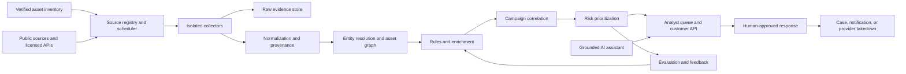

# Sentinel DRP: System Design

## 1. Purpose

Sentinel is a digital risk protection platform that continuously discovers and prioritizes externally observable threats to an organization's internet-facing assets, workforce, executives, and brands. It turns public signals into traceable findings and coordinated, human-approved response actions.

The current workspace is a browser-only demonstration. It does not connect to external sources, continuously monitor the internet, or perform takedowns. This document describes the production system that would be required to provide those capabilities.

## 2. Design Principles

- **External-first:** Monitor public sources and authorized data-provider APIs. Do not access private accounts, bypass access controls, or collect data from sources whose terms prohibit the activity.
- **Evidence before inference:** Every finding links to its source, observation time, collection method, and supporting evidence. Preserve a content hash and a permitted reference or snapshot where licensing allows.
- **Prioritize exposure, not volume:** Correlate a signal with the organization's asset graph and likely business impact. Deduplicate campaign noise and rank findings by urgency and confidence.
- **AI assists; people decide:** Models summarize, cluster, and explain evidence. Deterministic checks and analysts control severity changes, external notifications, and disruptive response actions.
- **Privacy by design:** Keep employee monitoring to defined professional-risk use cases, minimize personal data, restrict access, and set short retention periods.
- **Tenant isolation:** Separate every organization's assets, observations, model context, and response history.

## 3. Coverage

### Organization and infrastructure

- Domains, subdomains, DNS changes, certificate transparency records, exposed services, and newly registered lookalike domains.
- Public code repositories and package registries for accidental publication of organization-owned secrets or references to protected assets. Secret values are redacted immediately; never test a discovered credential.
- Public cloud and web exposure indicators, using authorized scanners or provider APIs for assets the customer has verified they own.
- Public vulnerability advisories and exploit activity mapped to the organization's declared products and technology stack.

### People and identity

- Publicly indexed professional profiles and posts that impersonate executives or named corporate roles.
- Publicly reported credential exposure from licensed, authorized breach-notification providers. Store a match indicator and necessary metadata, not plaintext passwords.
- Executive and employee-targeted phishing lures, fake support accounts, and fraudulent recruitment or payment requests.

### Brand and customer trust

- Lookalike domains, typosquatting, homoglyphs, suspicious certificates, and copied public brand assets.
- Public social platforms, app stores, advertising libraries, and web pages for fake accounts, counterfeit apps, scam promotions, and unauthorized use of brand identity.
- Publicly accessible discussion and threat-intelligence sources for campaign context, subject to source terms and applicable law.

Coverage depends on source availability and licensing. The product must show source health and blind spots rather than imply complete visibility. It does not promise access to private communities or unindexed content.

## 4. Reference Architecture



### Components

1. **Asset registry:** Customers verify domains, brands, subsidiaries, executive names, and approved technology identifiers. Each asset has an owner, criticality, scope, and verification history.
2. **Source registry and scheduler:** Each connector declares allowed collection methods, rate limits, terms, coverage, freshness target, and health checks. A scheduler runs polling, event/webhook ingestion, and targeted rescans.
3. **Collectors:** Isolated, least-privilege workers retrieve public records or authorized provider data. Enforce per-source quotas, safe URL handling, malware isolation, and strict egress controls.
4. **Evidence pipeline:** Normalize observations into a versioned schema, redact sensitive values at ingestion, attach provenance, deduplicate exact matches, and retain raw data only when collection terms and retention policy permit.
5. **Entity graph:** Link domains, certificates, infrastructure, brands, public accounts, campaigns, and verified organization assets. Keep inferred links distinct from verified ownership.
6. **Detection and enrichment:** Use deterministic checks for domain similarity, certificate/DNS changes, known indicators, exposed-secret patterns, and source-specific signals. Enrich with reputation and vulnerability data from approved providers.
7. **Correlation and risk engine:** Group related observations into campaigns, suppress duplicate alerts, and calculate an explainable priority from confidence, potential impact, asset criticality, exploit evidence, and recency.
8. **AI analyst assistant:** Produce evidence-grounded summaries, compare related findings, draft case notes, and recommend next steps. Require citations to stored observations; abstain when evidence is missing. Do not send customer data to a model provider unless the customer has explicitly enabled an approved processing arrangement.
9. **Case and response service:** Track ownership, decisions, evidence, and outcomes. Integrate with ticketing, SIEM/SOAR, registrar, hosting, and platform abuse-reporting workflows through scoped connectors.
10. **Control plane:** Manage tenants, source credentials, RBAC, audit logs, data retention, model settings, and connector health.

## 5. Detection and Prioritization

Use a two-stage approach: high-recall, explainable rules create candidate signals; asset-aware correlation and calibrated ranking determine what reaches the analyst queue. A model may assist with text classification or clustering, but it cannot independently declare a source malicious or authorize an external action.

Each finding should expose:

- **Confidence:** Strength and independence of the evidence, including whether a match is verified or inferred.
- **Impact:** Potential operational, financial, safety, or reputational harm to the linked asset.
- **Urgency:** Recency, active exploitation, ongoing campaign activity, and time-sensitive exposure.
- **Exposure:** Whether the observed item is publicly reachable and whether it plausibly targets the organization.
- **Provenance:** Source, first/last observed time, collection method, evidence references, and transformations applied.

Keep the component factors visible instead of presenting a score as certainty. A new lookalike domain with a valid certificate and an active credential-harvesting page should outrank a name-only similarity match. A low-confidence match should remain reviewable without being presented as a confirmed incident.

## 6. Finding Lifecycle

`Observed -> Normalized -> Correlated -> Prioritized -> Analyst review -> Action approved -> Resolved / Monitoring`

Analysts can confirm, dismiss, merge, assign, add context, or request a rescan. Dismissal reasons and customer feedback feed rule tuning and model evaluation, not unreviewed automatic policy changes. Reopen a resolved case when new evidence materially changes its confidence or impact.

Response options include internal ticket creation, notifications, evidence packages, customer-approved blocklists, and abuse or takedown submissions. Takedowns, public statements, account actions, and employee notifications require an authorized human decision and a recorded rationale.

## 7. Security and Privacy Controls

- Encrypt data in transit and at rest; isolate tenant keys and enforce tenant-scoped authorization at every service boundary.
- Use SSO, MFA, role-based access, least-privilege service identities, short-lived secrets, and immutable administrative audit events.
- Treat fetched pages, repository content, and social posts as hostile input. Never execute collected content; defend against prompt injection by keeping source text out of privileged instructions and tool control.
- Redact credentials, personal contact details, and unrelated sensitive content before indexing or model processing. Never validate, reuse, or attempt to log into accounts with discovered credentials.
- Define source-specific retention and deletion policies. Support customer export and deletion, legal holds, and documented data-processing terms.
- Scope employee-related collection to named, business-relevant risks. Provide customer-configurable watchlists, access controls, and auditability; do not build broad employee profiling or private-life surveillance.
- Maintain a source allowlist, crawler identification, request budgets, opt-out handling, and a review process for source terms and jurisdictional requirements.
- Log model/version, prompt template, evidence references, and analyst edits for AI-assisted outputs. Do not train shared models on customer data by default.

## 8. Core Finding Contract

```json
{
  "id": "finding_01J...",
  "tenant_id": "org_123",
  "type": "lookalike_domain",
  "title": "Possible credential-harvesting lookalike",
  "asset_ref": "brand:northstar.example",
  "observed_at": "2026-10-09T12:00:00Z",
  "first_seen_at": "2026-10-09T11:42:00Z",
  "source": { "name": "certificate_transparency", "record_ref": "source-record-456" },
  "confidence": 0.82,
  "impact": "high",
  "priority": "high",
  "evidence_refs": ["evidence-456", "evidence-457"],
  "explanation": "Domain similarity and a newly issued certificate match two independent signals.",
  "status": "needs_review",
  "recommended_actions": ["verify ownership", "inspect hosted page safely"]
}
```

This is a contract example, not a live observation. Evidence records should retain source-specific metadata and access controls without copying unnecessary personal or secret data into the finding.

## 9. Operational Targets

Set targets per connector and publish measured health in the product. Initial targets for supported, healthy sources:

- Ingest event-driven observations within 15 minutes and scheduled observations within the connector's published polling interval.
- Make a normalized observation searchable within 5 minutes of successful collection.
- Attach provenance and evidence references to 100% of customer-visible findings.
- Track connector freshness, collection failures, queue lag, deduplication rate, false-positive rate, analyst time-to-triage, and confirmed-threat response time.
- Evaluate detections on time-separated, labeled datasets; report precision and recall by source and threat category, with drift monitoring and analyst appeal rates.

These are service objectives to validate during a pilot, not guarantees of detecting every threat.

## 10. Delivery Plan

1. **Foundation:** Asset verification, tenant controls, source registry, provenance schema, connector health, and analyst case workflow.
2. **External exposure:** Domain/certificate monitoring, lookalike detection, public repository scanning for customer-owned identifiers, and vulnerability/advisory matching.
3. **Brand and identity:** Licensed social/app-store/credential-exposure providers, campaign correlation, privacy review, and evidence-grounded summaries.
4. **Response:** Ticketing and SIEM integrations, approval-based abuse/takedown workflows, customer feedback, and measured detection quality.

Start with a small set of well-understood sources and customer-verified assets. Expand coverage only after source rights, quality, retention, and analyst workload are measured. The existing browser demo can visualize these workflows with clearly labeled sample data; real continuous monitoring requires the backend, source agreements, and security controls described above.